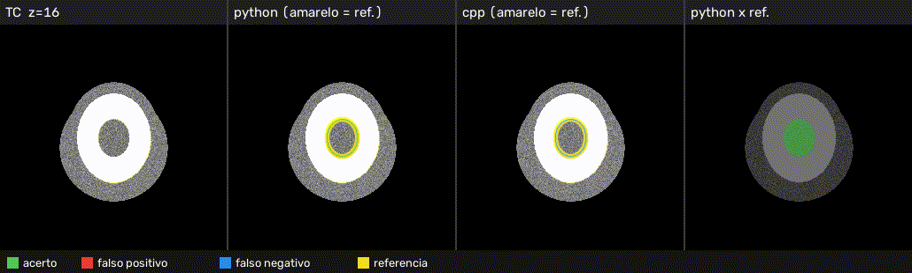
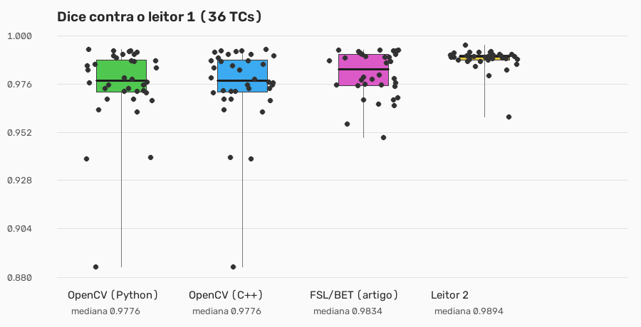
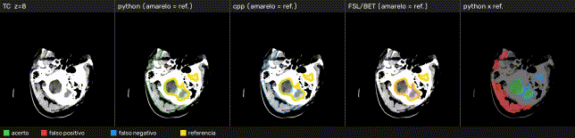

# Segmentação de parênquima cerebral em TC (sem FSL)

Reimplementação da extração de cérebro de **Muschelli et al. (2015)**, *Validated automatic brain extraction of head CT
images* (NeuroImage 114:379–385), usando **apenas OpenCV**. Não usa FSL, FLIRT nem BET. Há duas versões que produzem
máscaras idênticas: Python (ambiente `uv`) e C++17.

```
artigo/            referência e resumo do método original
python/ctbet_cv/   implementação Python (pacote do projeto uv)
cpp/               implementação C++ (include/ + src/ + Makefile)
scripts/compare.sh comparação de tempo e métricas Python × C++
scripts/avaliar_stroke_ct.sh  avaliação no dataset real do artigo
figuras/           figuras de exemplo (fantoma) e resultados reais (figuras/stroke_ct_2019)
```

## Método

| etapa | artigo (FSL) | aqui (OpenCV) |
|---|---|---|
| 1 | limiar 0–100 HU | igual |
| 2 | gaussiana 3D σ = 1 mm + novo limiar | igual (`sepFilter2D` no plano + 1D entre fatias); o voxel original também precisa estar em 0–100 HU |
| 3 | BET, FI 0,01 / 0,1 | erosão 2D (elipse, 4 mm) → maior componente conexo 3D → dilatação restrita à candidata |
| 4 | preenchimento de buracos | `floodFill` fatia a fatia |
| — | (CT-preprocess) registro no MNI152 com FLIRT | não há registro |

A erosão corta pontes finas entre o cérebro e os tecidos extracranianos (órbitas, forames da base do crânio). O maior
componente 3D descarta o couro cabeludo e o pescoço. A dilatação devolve a borda perdida na erosão.

## Python (uv)

```bash
uv sync
uv run ctbet-cv segment ct.nii.gz mascara.nii.gz --brain cerebro.nii.gz
uv run ctbet-cv metrics mascara.nii.gz mascara_manual.nii.gz
uv run ctbet-cv phantom data/phantom_ct.nii.gz data/phantom_gt.nii.gz   # fantoma de teste
```

Opções de `segment`: `--lower 0 --upper 100 --sigma 1 --brain-min 5 --erosion 4`.
Depende só de `opencv-python-headless` (e do NumPy, que vem com ele). O NIfTI é lido e escrito por um leitor próprio
(`nifti.py`).

## C++

```bash
brew install opencv pkg-config      # macOS (Ubuntu: sudo apt install libopencv-dev zlib1g-dev)
make -C cpp                         # gera cpp/bin/ctbrain_cv
make -C cpp debug                   # -O0 -g com AddressSanitizer + UBSan
cpp/bin/ctbrain_cv segment ct.nii.gz mascara.nii.gz [--brain cerebro.nii.gz] [mesmas opções]
cpp/bin/ctbrain_cv metrics mascara.nii.gz mascara_manual.nii.gz
```

Organização: `volume.hpp` (pilha de `cv::Mat`), `nifti.hpp` (E/S via zlib, com suporte a endianness),
`segmentation.hpp` (pipeline), `metrics.hpp`, `timer.hpp`. Usa RAII, sem `new`/`delete`, erros via exceção e
`-Wall -Wextra -Wpedantic -Wshadow -Wconversion` sem avisos. O build liga só `opencv_core` e `opencv_imgproc`.

## Comparação

```bash
scripts/compare.sh                         # usa o fantoma sintético
scripts/compare.sh -i ct.nii.gz -g manual.nii.gz -n 10
```

O script gera `results/timings.jsonl`, `results/metrics.jsonl`, `results/summary.md` e as máscaras. Ele mede o tempo de
parede do processo e os tempos internos de leitura, segmentação e escrita. Também calcula Dice, Jaccard, sensibilidade,
especificidade e diferença de volume entre Python e C++ e de cada um contra a referência.

Ele também gera `results/figuras/`:

- `comparacao_fatias.png`: 6 fatias. Cada linha mostra a TC, os contornos das máscaras Python e C++ (amarelo = referência) e
  o mapa de diferenças (verde = acerto, vermelho = falso positivo, azul = falso negativo).
- `comparacao_fatias.gif`: o mesmo, percorrendo todas as fatias com cérebro.
- `tempos.png`: barras com o tempo mediano de cada implementação.

Para gerar as figuras avulsas (qualquer número de máscaras):

```bash
uv run ctbet-cv visualize ct.nii.gz --mask python=a.nii.gz --mask cpp=b.nii.gz \
    [--ref manual.nii.gz] [--out pasta] [--slices 8] [--flip-y] [--timings results/timings.jsonl]
```

Use `--flip-y` se a imagem aparecer de cabeça para baixo (dados em RAS). Gravar GIF exige OpenCV ≥ 4.11.



Resultado no fantoma (256×256×60, 0,9×0,9×3 mm), numa VM Linux de 2 núcleos:

| impl | segmentação | processo | Dice vs referência |
|---|---|---|---|
| Python | ~580 ms | ~860 ms | 0,998 |
| C++ | ~95 ms | ~185 ms | 0,998 |

Python e C++: Dice = 1,000 (máscaras idênticas).

> O fantoma serve só para testar o código. A validação de verdade está na seção abaixo.

## Avaliação em TC real (dataset do artigo)

O dataset é o **"Non-Contrast Head CT of Stroke Patients with Brain Masks"**, que acompanha o artigo
([JHU Data Archive, doi:10.7281/T1/CZDPSX](https://archive.data.jhu.edu/dataset.xhtml?persistentId=doi:10.7281/T1/CZDPSX),
licença CC BY-NC 4.0). São 35 pacientes com hemorragia intracerebral dos ensaios MISTIE/CLEAR, totalizando 37 TCs sem
contraste. Cada TC tem a máscara manual de dois leitores e a máscara gerada pelo método original (FSL/BET).

```bash
# baixe 01.tar.xz … 35.tar.xz (≈305 MB) para data/stroke_ct_2019/tarballs/ e rode:
scripts/avaliar_stroke_ct.sh
```

O script extrai os dados e roda Python e C++ em todas as TCs. Ele compara cada máscara com os dois leitores e grava
`metricas_por_tc.csv`, `resumo.md`, o boxplot e as figuras (PNG + GIF) do pior caso, do caso mediano e do melhor caso.
Os dados não vão para o git (`data/` está no `.gitignore`).

Resultado com os parâmetros padrão, **sem nenhum ajuste nesses dados** (37 TCs; contra o leitor 1, n = 36):

| método | Dice médio ± dp | Dice mediano | Dice mínimo | sensibilidade | especificidade |
|---|---|---|---|---|---|
| OpenCV (Python e C++, máscaras idênticas) | 0,975 ± 0,020 | 0,978 | 0,885 | 0,966 | 0,998 |
| FSL/BET (método do artigo) | 0,981 ± 0,011 | 0,983 | 0,949 | 0,973 | 0,998 |
| Leitor 2 (concordância entre humanos) | 0,988 ± 0,006 | 0,989 | 0,960 | 0,981 | 0,999 |

Tempo de segmentação por TC (512×512, cerca de 30 a 70 fatias): Python ≈ 0,96 s e C++ ≈ 0,34 s (medianas; o C++ é
≈ 2,8× mais rápido). As máscaras das duas versões coincidem em 100 % das TCs (Dice = 1,0).

Leitura dos resultados: a versão só com morfologia fica cerca de 0,006 de Dice abaixo do BET na mediana e é mais
instável nos casos difíceis. O BET foi melhor em 30 das 36 TCs. As falhas ficam na **base do crânio**: nas fatias das
órbitas e da fossa posterior, a erosão de 4 mm não separa o cérebro das partes moles da face (falso positivo) e, ao
mesmo tempo, corta pedaços do lobo temporal (falso negativo). O pior caso é o 32 (Dice 0,885).



